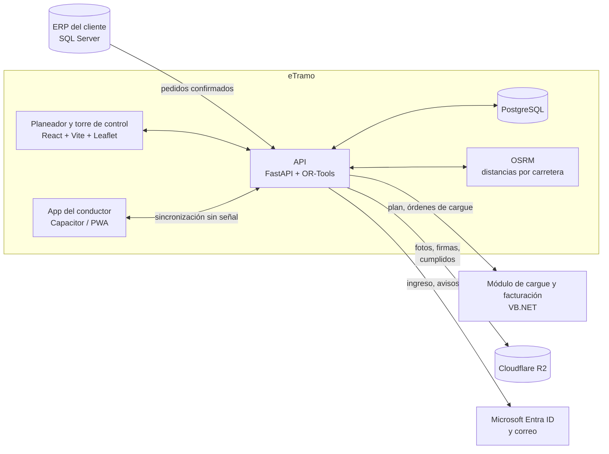

# eTramo: planeación y control de despachos para distribución de acero

**Caso de estudio** · [Read in English](README.md)

eTramo es un producto SaaS que diseñé y construí en mi empresa, **Emperador Soluciones**. Convierte los pedidos confirmados del ERP en rutas optimizadas para los camiones, sigue cada vehículo en vivo y cierra cada entrega con su cumplido firmado. El primer cliente es una distribuidora nacional de acero con sucursales en toda Colombia, y el sistema entra en piloto en noviembre de 2026.

> El código es privado y, por contrato, el cliente se mantiene anónimo. Este documento describe el problema, la arquitectura y las decisiones detrás del producto.

**Mi rol:** fundador, arquitecto e ingeniero líder. Me encargué de los requerimientos con el área de TI del cliente, el modelo de datos, el backend, el motor de ruteo, la web, la app del conductor, las integraciones y el despliegue.

---

## El problema

Despachar acero no es una entrega de última milla cualquiera:

- **El largo importa tanto como el peso.** Una varilla de 12 m no cabe en un camión de 6 m, aunque le sobre capacidad.
- **Un pedido grande no se reparte así no más.** Cuando un pedido excede la capacidad de un camión, el ERP necesita un *pedido hijo* formal.
- **Los clientes tienen reglas:** ventanas de entrega (minas que solo reciben de 06:00 a 14:00), zonas restringidas para tractomulas en el centro de las ciudades y un cierre contable mensual después del cual no reciben nada.
- **Los conductores trabajan donde no hay señal:** canteras, minas y carreteras. Muchos son terceros que usan su propio celular.
- **El ERP y el módulo de cargue y facturación siguen siendo los sistemas oficiales.** La nueva herramienta debe integrarse con ellos, no reemplazarlos.

La planeación se hacía a mano, sucursal por sucursal, con hojas de cálculo y llamadas, y no había una vista en vivo de los camiones.

## Lo que construí

| Módulo | Qué hace |
|---|---|
| **Planeador** | Importa los pedidos confirmados y arma las rutas por sucursal, para uno o varios días y con varios viajes por vehículo. Cada viaje se presenta como un tiquete de báscula. El planificador ajusta arrastrando pedidos y publica el plan al ERP. |
| **Torre de control** | Mapa en vivo de cada vehículo, estado de las entregas, horas estimadas recalculadas y retrasos. Las novedades siguen un flujo (abierta → en gestión → resuelta). Mensajes a los conductores. Cancelación o reprogramación de paradas. |
| **Rastreo** | Ruta planeada frente a la recorrida, repetición de cada viaje y alertas automáticas por desvío, detención no programada o pérdida de GPS. |
| **App del conductor** (Android + web) | Una tarea por pantalla, con botones grandes para usar a pleno sol y con guantes. Registra la llegada, las cantidades entregadas, las fotos y la firma, y genera el cumplido. **Funciona hasta 24 horas sin señal.** |
| **Línea de tiempo** | Lo planeado frente a lo real, por viaje, pedido o vehículo. |
| **Datos y reglas** | Control de calidad de datos, flota editable, reglas de planeación y **zonas restringidas dibujadas en el mapa**. |

## Arquitectura

**Tecnologías:** Python, FastAPI, Google OR-Tools, SQLAlchemy + Alembic, PostgreSQL, OSRM, React 19, TypeScript, Vite, Leaflet, Capacitor (Android), Cloudflare R2, Microsoft Entra ID, Railway.

## Decisiones técnicas clave

### 1. El ruteo como un problema de optimización con restricciones
Las rutas se resuelven como un **problema de ruteo de vehículos (VRP) con OR-Tools**, con varias sucursales de salida, varios días y varios viajes por vehículo. Las restricciones incluyen la capacidad en kg, el largo máximo del material por tipo de vehículo, las ventanas de entrega, las zonas restringidas, la jornada y el cierre contable del cliente. Los pedidos vencidos tienen una penalización para que salgan primero. Las distancias son reales por carretera, calculadas con OSRM y guardadas en caché en la base de datos.

**Explicar cada decisión:** cada pedido que queda sin asignar trae su motivo y una sugerencia ("excede la capacidad: se proponen 2 pedidos hijo", "bloqueado por zona restringida"). El optimizador propone y el planificador decide.

### 2. App del conductor que funciona sin señal, con sincronización idempotente
Los conductores pierden la señal durante horas, y una entrega perdida o duplicada es inaceptable.
- Cada acción del conductor se guarda primero en una **cola local** con un **identificador de operación UUID v7** generado en el celular, junto con la hora real del hecho.
- El servidor registra cada `op_id` en una tabla de sincronización. Si la misma operación llega dos veces (reintentos, señal intermitente), devuelve el resultado guardado **sin aplicarla otra vez**.
- **Los archivos van primero:** fotos y firmas se suben a `PUT /api/archivos/{sha256}`, que es idempotente por la huella del contenido. La operación solo lleva la huella, así una entrega nunca queda apuntando a una foto que no llegó.
- **Reglas de conflicto explícitas:** el celular manda en lo que hizo el conductor y el servidor manda en lo que decidió Control. Si un conductor entrega sin señal en una parada que Control canceló, no se pierde nada: la entrega queda registrada y se abre una novedad automática.
- En cada sincronización se mide y se corrige el desfase del reloj del celular.

### 3. Un modelo relacional donde cada fila tiene dueño
- **PostgreSQL es la única fuente de verdad.** Cada objeto del negocio (pedido, viaje, parada, entrega, novedad, foto) es una fila con llaves foráneas. JSONB se usa solo para datos externos y parámetros del optimizador.
- **Cada escritura queda amarrada a quien la hizo** (usuario o conductor, y el dispositivo en las acciones desde el celular).
- **Nada se borra:** los registros se inactivan, se anulan o se reemplazan por una versión nueva que apunta a la anterior.
- **Dueño por campo:** los campos del ERP se sobrescriben al sincronizar y nunca se editan en eTramo, y los de eTramo nunca los toca el ERP.
- **Todo cambio de estructura pasa por una migración de Alembic** y se prueba en un esquema aislado, nunca sobre los datos reales.

### 4. Integrarse, no reemplazar
El ERP y el módulo de cargue y facturación siguen siendo los sistemas oficiales. eTramo lee una vista de los pedidos confirmados, publica el plan por una API versionada (`/api/.../v1`) y le entrega al módulo de cargue el orden de carga (inverso al de entrega). Los usuarios de oficina ingresan con **Microsoft Entra ID**. Los conductores, con placa y PIN.

## Del demo a producción

La primera versión fue un demo funcional sobre SQLite y con un reloj simulado, hecho para ganar el negocio. Convertirlo en producto se planeó en siete etapas, cada una con su migración, su paso de datos y sus pruebas:

- Maestros con llaves foráneas reales, tipos de vehículo, transportadoras y zonas restringidas.
- Pedidos y líneas de pedido como tablas, alimentadas por un simulador del ERP mientras el cliente entrega su endpoint.
- El plan completo (viajes, paradas, entregas, novedades, cargue) pasó de un documento JSON a **más de 25 tablas relacionales**, verificado campo por campo.
- Fotos, firmas y cumplidos pasaron a almacenamiento de objetos con huella de contenido, y **más de 2.600 distancias por carretera en caché** pasaron a la base de datos.
- Se retiró el reloj simulado. El sistema opera con la hora real de Colombia usando `timestamptz`.
- Sincronización sin señal con dispositivos, identificadores de operación y corrección del desfase del reloj.

## Estado

- Contrato firmado. **El piloto empieza en noviembre de 2026.**
- Pendiente para producción: conector con el ERP de solo lectura y conexiones de salida, OSRM propio con el mapa de Colombia, geocodificación de direcciones y archivo de los cumplidos.

## Lo que destacaría

- Convertir las reglas reales de una industria (largo del material, pedidos hijo, cierre contable) en restricciones de optimización en las que un planificador pueda confiar.
- Diseñar una sincronización sin señal que no pueda perder ni duplicar una entrega.
- Llevar un demo a un modelo de datos de producción sin detener el producto.

---

*Young Sierra · Fundador e Ingeniero Líder, Emperador Soluciones · [github.com/YoungSierra](https://github.com/YoungSierra)*
