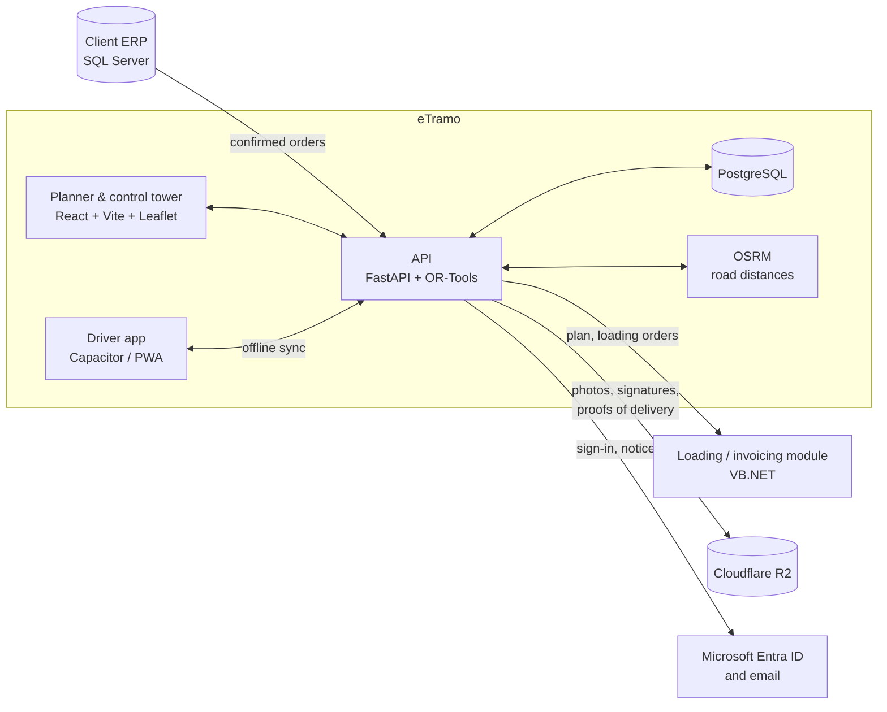

# eTramo: dispatch planning and control for steel distribution

**Case study** · [Leer en español](README.es.md)

eTramo is a SaaS product I designed and built at my company, **Emperador Soluciones**. It turns confirmed orders from an ERP into optimized truck routes, tracks every vehicle live, and closes each delivery with a signed proof of delivery. The first client is a national steel distributor with branches across Colombia, and the system enters its pilot in November 2026.

> The source code is private and the client is anonymous by contract. This document describes the problem, the architecture, and the decisions behind the product.

**My role:** founder, architect, and lead engineer. I handled the requirements with the client's IT team, the data model, the backend, the routing engine, the web app, the driver app, the integrations, and the deployment.

---

## The problem

Dispatching steel is not generic last-mile delivery:

- **Length matters as much as weight.** A 12 m rebar does not fit in a 6 m truck, even if the truck has spare capacity.
- **Large orders cannot simply be split.** When an order exceeds a truck's capacity, the ERP needs a formal *child order*.
- **Customers have rules:** delivery windows (mines that receive only from 06:00 to 14:00), restricted zones for heavy trucks in city centers, and a monthly accounting close after which they accept nothing.
- **Drivers work where there is no signal:** quarries, mines, and highways. Many are contractors using their own phones.
- **The ERP and the loading/invoicing module must remain the systems of record.** The new tool has to integrate with them, not replace them.

Planning was done by hand, branch by branch, with spreadsheets and phone calls, and there was no live view of the trucks.

## What I built

| Module | What it does |
|---|---|
| **Planner** | Imports confirmed orders and builds routes per branch for one or several days, with several trips per vehicle. Each trip is shown as a weigh ticket. The planner adjusts by drag and drop and publishes the plan to the ERP. |
| **Control tower** | Live map of every vehicle, delivery status, recalculated ETAs, and delays. Incidents follow a workflow (open → in progress → resolved). Messages to drivers. Cancelling or rescheduling stops. |
| **Tracking** | Planned route compared with the route actually driven, replay of each trip, and automatic alerts for route deviation, unplanned stops, or lost GPS. |
| **Driver app** (Android + web) | One task per screen, with large buttons for use in full sun and with gloves. Records arrival, delivered quantities, photos, and signature, and generates the proof of delivery. **Works offline for up to 24 hours.** |
| **Timeline** | Planned vs. actual, by trip, order, or vehicle. |
| **Data & rules** | Data-quality checks, editable fleet, planning rules, and **restricted zones drawn on the map**. |

## Architecture

**Stack:** Python, FastAPI, Google OR-Tools, SQLAlchemy + Alembic, PostgreSQL, OSRM, React 19, TypeScript, Vite, Leaflet, Capacitor (Android), Cloudflare R2, Microsoft Entra ID, Railway.

## Key technical decisions

### 1. Routing as a constrained optimization problem
Routes are solved as a **Vehicle Routing Problem with OR-Tools**, with several departure branches, several days, and several trips per vehicle. The constraints include capacity in kg, maximum material length by vehicle type, delivery windows, restricted zones, working hours, and the customer's accounting close. Overdue orders carry a penalty so they leave first. Distances are real road distances from OSRM, cached in the database.

**Explain every decision:** each unassigned order comes with a reason and a suggestion ("exceeds capacity: propose 2 child orders", "blocked by restricted zone"). The optimizer proposes and the planner decides.

### 2. Offline-first driver app with idempotent sync
Drivers lose signal for hours, and a lost or duplicated delivery is unacceptable.
- Every driver action is written first to a **local queue** with a **UUID v7 operation id** generated on the phone, plus the real time of the event.
- The server records each `op_id` in a sync table. If the same operation arrives twice (retries, intermittent signal), it returns the stored result **without applying it again**.
- **Files go first:** photos and signatures are uploaded to `PUT /api/archivos/{sha256}`, which is idempotent by content hash. The operation only carries the hash, so a delivery can never point to a photo that never arrived.
- **Explicit conflict rules:** the phone wins on what the driver did, and the server wins on what Control decided. If a driver delivers offline to a stop that Control cancelled, nothing is lost: the delivery is kept and an automatic incident is opened.
- Phone clock drift is measured on every sync and corrected.

### 3. A relational model where every row has an owner
- **PostgreSQL is the single source of truth.** Every business object (order, trip, stop, delivery, incident, photo) is a row with foreign keys. JSONB is used only for external payloads and optimizer parameters.
- **Every write is tied to its actor** (user or driver, and the device for mobile actions).
- **Nothing is deleted:** records are deactivated, voided, or replaced by a new version that points to the old one.
- **Ownership per field:** ERP fields are overwritten on sync and never edited in eTramo, and eTramo's fields are never touched by the ERP.
- **Every schema change goes through an Alembic migration** and is tested in an isolated `pruebas` schema, never against production data.

### 4. Integrate, don't replace
The ERP and the loading/invoicing module remain the systems of record. eTramo reads a view of confirmed orders, publishes the plan through a versioned API (`/api/.../v1`), and gives the downstream module a loading order (reverse of the delivery order). Office users sign in with **Microsoft Entra ID**. Drivers use plate + PIN.

## Migration from demo to production

The first version was a working demo built on SQLite and a simulated clock to win the deal. Turning it into a product was planned in seven stages, each with its own migration, data transfer, and tests:

- Master data with real foreign keys, vehicle types, carriers, and restricted zones.
- Orders and order lines as tables, fed by an ERP simulator until the client's endpoint is ready.
- The full plan (trips, stops, deliveries, incidents, loading) moved from a JSON document into **25+ relational tables**, verified field by field.
- Photos, signatures, and proofs of delivery moved to object storage with content hashes, and **2,600+ cached road distances** moved into the database.
- The simulated clock was removed. The system now runs on real Colombian time with `timestamptz`.
- Offline sync with devices, operation ids, and clock-drift correction.

## Status

- Contract signed. **Pilot starts in November 2026.**
- Planned for production: ERP connector with outbound-only reads, self-hosted OSRM with the Colombia map, address geocoding, and archiving of proofs of delivery.

## What I'd highlight

- Translating an industry's real rules (material length, child orders, accounting close) into optimization constraints that a planner can trust.
- Designing offline sync that can neither lose nor duplicate a delivery.
- Taking a demo to a production-grade data model without stopping the product.

---

*Young Sierra · Founder & Lead Engineer, Emperador Soluciones · [github.com/YoungSierra](https://github.com/YoungSierra)*
